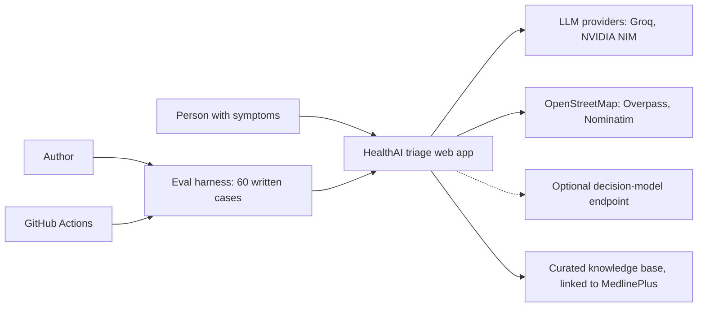

# Detailed High-Level Design

Why HealthAI triage is built the way it is: the problem, the goals and non-goals, the components and data flow, where AI is allowed to decide and where it is not, and what happens when parts fail. For diagrams of the running system see [architecture.md](architecture.md); for modules and signatures see [LLD.md](LLD.md); for measured outcomes see [results.md](results.md).

> **Not a medical device.** HealthAI triage is a portfolio project. It can be wrong, it has not been clinically validated, and it must not be used to decide whether to seek care. In an emergency, call 112.

## 1. Problem

Someone with chest tightness at 2 a.m. can search the web and read a list of frightening possibilities, wait until morning, or go to a hospital. Symptom checkers promise to help but tend to fail in two ways:

- **Confidently wrong.** A number such as "87% match" with nothing behind it, or a language model that talks itself out of an emergency.
- **Uncheckable.** There is no way to see why a level was chosen or what it was based on.

The earlier version of this project had both faults: it displayed a confidence percentage drawn from `random.uniform(0.79, 0.89)`. That was removed (see [errorlog.md](errorlog.md)).

## 2. Goals and non-goals

**Goals**

1. Never talk anyone out of an emergency. A missed emergency is the failure that matters most, so it is the headline metric.
2. Show the reasoning and the sources, so the answer can be checked rather than trusted.
3. Say plainly when the AI is not involved. With no model available the system uses rules and says so; it never invents a confidence number.
4. Give a next step: real nearby hospitals, clinics or pharmacies.
5. Be inspectable: every model call and every finished check is logged and visible on an Ops page; the quality evidence is published on an Evals page.
6. Run cheaply: one small API process, no heavy model in the process, no account.

**Non-goals**

- It is **not a medical device** and makes no diagnosis. "Things a doctor may consider" is context, not a diagnosis.
- No clinical validation. The 60 evaluation cases are written by the author from public guidance.
- No prescriptions, doses or medication advice (the agent prompt forbids it; the `medications` field is always empty).
- No accounts, no stored identity, no long-term health record. Results are kept in the visitor's browser.
- No multilingual support yet: intake and output are English, and the emergency number 112 is hard-wired. (Language detection and a few Hindi yes/no spellings exist but nothing is translated.)
- No claim of real-world accuracy of the AI agent or of the optional decision model. Neither has been measured here.

## 3. Context

External parties and what is sent to them:

| Party | Receives | Notes |
|---|---|---|
| LLM provider (Groq, then NVIDIA NIM) | The complaint, age, sex, typed answers and tool results | Only while processing a check; no name or account exists to send |
| Overpass, Nominatim | A rounded location or a typed place name | Only when the person asks for nearby care |
| Decision-model endpoint | A text summary of the case | Only if `DECISION_MODEL=systemone`; off by default |
| Render | Hosts the API and static site | Secrets are set in its dashboard |

## 4. Components

| Component | Responsibility | Deterministic? |
|---|---|---|
| Red-flag rules (`red_flags.py`) | Regex rules plus answer-based and age rules produce an escalation floor | Yes |
| NLP engine (`nlp_engine.py`) | Symptoms, duration, severity from free text | Symptoms: LLM with deterministic fallback; the rest regex |
| Adaptive question engine (`adaptive_engine.py`, `answers.py`) | Picks up to six typed follow-up questions from a symptom graph; validates answers | Selection deterministic plus an optional model filter; validation deterministic |
| Triage agent (`agent.py`) | Tool-calling loop that proposes a level, reasons and citations | No (LLM) |
| Rule-based assessment (`agent.rules_assessment`) | Fallback proposal from the symptom graph, severity and duration | Yes |
| Retrieval (`rag.py`) | Hybrid dense plus keyword search over 62 chunks of 23 curated notes | Yes (a static embedding model, no generation) |
| Decision model (`decision_model.py`) | Optional second opinion with conformal prediction sets | Probabilities from an external model; conformal step is deterministic maths |
| Safety merge (in `agent.assess`) | Final level is the highest of all signals | Yes |
| Facilities (`facilities.py`) | Nearby places from OpenStreetMap | Yes |
| Observability (`observability.py`) | Logs every model call and finished check | Yes |
| Web app (`frontend/`) | Intake, questions, result, history, evals, ops, tour | Yes |

## 5. Data flow

1. The person enters a complaint, age and optional sex. The API extracts symptoms and runs the red-flag rules on the text.
2. An emergency sign or a self-harm statement ends the conversation early: the case is assessed immediately. Otherwise the app asks up to six typed questions; each answer is validated, and the rules re-scan the complaint and all answers after every answer.
3. The case is assessed: rules floor, agent proposal (with retrieval and symptom lookups), optional second opinion, safety merge, fixed action text.
4. The result carries the level, the reasons, the red flags that fired, only the citations that were retrieved, the full step trace, and which path produced it.
5. The browser stores the result locally and can request nearby care for that level.

Only the case record (complaint, age, sex, answers, result and trace) is stored server-side; there is no account and no name. The audit log stores a hash of the client IP, not the IP.

## 6. The AI versus deterministic boundary

The design question for each step is: does a wrong output here risk someone being told to stay home during an emergency? If yes, the step is deterministic or is bounded by something deterministic.

| Step | Who decides | Why |
|---|---|---|
| Is there a textbook emergency sign? | Rules | Must be right, must be readable line by line, must not drift when a provider changes a model |
| Is this a self-harm crisis? | Rules, then fixed text | A model should not improvise here; helplines and 112 are shown without any model call |
| Which symptoms did the person mention? | LLM, with a keyword fallback; output limited to a fixed list of 16 valid symptoms | Language is messy; the allow-list prevents invented symptoms |
| Which follow-up questions to ask | Symptom graph order; an optional model filter drops redundant ones | Saves the person time; the safety floor does not depend on it |
| Judgement cases without textbook wording ("his words are all jumbled") | LLM agent | This is where rules fall short and the agent is meant to earn its place |
| Which sources to cite | Retrieval, then verified: citations not retrieved in this run are dropped | A model must not invent sources |
| What to do next (action text) | Fixed table: Emergency text says call 112 | The model's own wording is ignored, so advice such as a wrong emergency number cannot appear |
| Final level | max(agent, rules, conformal set) | Escalate only |
| Confidence | Not asserted | A probability appears only when a model supplied it, and is labelled |

### Why escalate-only

The two possible errors are not equal. Over-triage costs a visit to a clinic; under-triage of an emergency can cost a life. The merge is therefore a maximum over independent signals, so any single safety layer (rules, agent, second opinion) can raise the level and none can lower it. This has three useful consequences:

- A model failure or a prompt-injection attempt can at worst produce a higher or equal level than the rules floor, never a lower one.
- Each layer can be tested in isolation: `escalate` and `escalate_with_set` have tests that show they never lower a level.
- It makes the trade-off visible. The cost shows up as over-triage, which is measured in the eval (1 of 60 cases for the rules pipeline).

Escalate-only does not make the system safe by itself. If every layer misses, nothing raises the level. The rules-only evaluation shows this: two emergencies worded without textbook signs are told "home care" (see [results.md](results.md)). The agent exists to close that gap, but its performance has not been measured in this repository.

## 7. Safety design

- **Floor first.** Rules run before any model and again after the assessment.
- **Negation-aware.** "No chest pain" does not fire the chest-pain rule; "not breathing" still does. This came from an eval finding (see [errorlog.md](errorlog.md)).
- **Conservative defaults.** An invalid label from the model becomes Urgent, not HomeCare.
- **Crisis path with no model.** Self-harm statements skip the agent and the second opinion and show helplines and 112.
- **Visible provenance.** The result states whether the agent or the rules produced it, why a fallback was used, and what the proposal alone would have been when a rule raised the level.
- **Honest uncertainty.** No fabricated confidence number; no invented sources; unretrieved citations are dropped.
- **Gates.** CI fails on any missed red-flag emergency in the rules eval. The agent eval, when a key secret is configured, requires zero missed emergencies and at least 90% emergency recall.
- **Not a medical device** statement is shown in the app, in the README and in this document.

## 8. Scalability

| Concern | Today | Limit | Next step |
|---|---|---|---|
| API | One Python process | In-progress sessions are in process memory | Enable Redis for session context, then run several instances behind a load balancer |
| Database | SQLite on the instance disk | Resets on deploy | Postgres (`schema.sql` exists) and a separate store for observability |
| Model calls | Synchronous, two providers, 25 s timeout each | A slow provider holds a worker thread; up to six turns per check | Queue and per-provider rate limiting; response caching; a third provider |
| Retrieval | 62 chunks, embedded in memory at start-up | Fine up to a few thousand chunks | A vector store beyond that, plus a content review process |
| Nearby care | Live Overpass query, cached one hour per rounded location | Public servers; unbounded in-memory cache | Cache by area with eviction; a second place source |
| Quality | 60 author-written cases | Too small for clinical claims | Clinician-labelled set, re-run on every change |
| Observability | SQLite plus an Ops page | Single node | Export to a standard collector and alert on missed-emergency and error rates |

The embedding model is a 30 MB numpy-only static model, chosen so a small server does not need PyTorch.

## 9. Failure modes and degradation

| Failure | Effect on the person | Effect on safety |
|---|---|---|
| Primary provider down or rate-limited | None; the second provider answers | None |
| Both providers down, or no key configured | Rule-based assessment; the page says AI was not used | Floor unchanged; judgement cases may be under-triaged |
| Agent returns nothing usable | Same as above (`agent_failed`) | Same |
| Model returns an invalid label | Treated as Urgent | Conservative |
| Embedding model missing | Keyword retrieval; sources less relevant | None |
| Decision model down, uncalibrated or slow | No second opinion | None; it could only have raised the level |
| Overpass or Nominatim down | "Map service didn't respond" message | None; the 112 instruction is independent of the map |
| Observability database error | None | None |
| API restart in the middle of a check | The session is lost (in-memory context); the person starts again | None |
| Static host without a rewrite rule | Direct links to `/result/...` render a blank page | None; fixed by a rewrite in `render.yaml` |
| Unhandled exception | Plain "something went wrong" message | The error is logged; no partial result is shown |

## 10. Security and privacy

- **Secrets** live in environment variables and the host's dashboard; `.env` and `*.db` are git-ignored. CodeQL, OpenSSF Scorecard and grouped monthly Dependabot updates run on the repository.
- **CORS** is an allowlist (`CORS_ORIGINS`) with credentials off. An earlier wildcard-with-credentials configuration was replaced (see [errorlog.md](errorlog.md)).
- **Input validation** is at the edge: Pydantic limits on complaint length (3-1000 characters), age (0-120), `source` pattern, and per-type answer validation (scale 1-10, choice from options, text up to 500).
- **Path safety**: eval report names go through `os.path.basename`.
- **Privacy**: no account; results stay in the browser; the server stores the case record only; the audit log keeps a truncated SHA-256 of the IP. The text of the complaint is sent to the LLM provider while the check runs, which a deployment should disclose.
- **Prompt injection**: the free-text complaint reaches the model. The design limits the damage because the model cannot lower the level set by the rules, cannot choose the action text, and its citations are verified.
- **Not covered**: no authentication or rate limiting on the API, so a public deployment could be used to spend the LLM quota; this is acceptable for a demo and would need fixing before real use. Some unused leftovers from the earlier version (JWT helpers, user schemas) remain in the code.

## 11. Trade-offs and alternatives rejected

| Decision | Alternative | Why this way |
|---|---|---|
| Tool-calling agent over a small knowledge base | A single prompt, or a fine-tuned classifier | Tools make the evidence visible (what was looked up, what was cited) and let the trace be shown to the person |
| Deterministic red-flag regex as the floor | Ask the model to flag emergencies | A model can be talked out of an emergency or change behaviour when a provider swaps a model; rules cannot, and can be read line by line. Cost: brittle on unusual wording, hence the agent on top |
| Escalate-only merge | Let the agent override rules downward when it is "confident" | Asymmetric harm; no measured evidence that would justify lowering |
| Conformal prediction for the optional second opinion | Show raw model probabilities, or trust a threshold | Gives a coverage statement (`>= 1 - alpha` under exchangeability) that does not need a well-calibrated model. With only 60 calibration cases the quantile is coarse, so it is a demonstration of method |
| Decision model optional and off by default | Make it required | No endpoint was available to evaluate here, and a safety feature that is not measured should not be on |
| Fixed action table | Let the model write the action | The model's free text once surfaced "911" in advice for a 112 deployment; the table makes the instruction auditable |
| Static embedding model (model2vec) plus keyword | Sentence-transformer or hosted embeddings, a vector database | Small enough to run on a starter instance; 62 chunks do not need a vector database |
| SQLite | Postgres from day one | No extra service for a demo; a Postgres schema is ready |
| OpenStreetMap | A commercial maps API or a model-written list | Real data, no key, and a model can invent hospitals and phone numbers |
| Two LLM providers with failover | One provider | One outage should not stop the agent. The free tiers retire model ids; the defaults changed once already |
| In-memory session context | Redis by default | Simpler for a single instance; Redis support exists behind a flag |
| Author-written eval, published with its limits | No eval, or clinician claims | Honest and cheap; enough to catch regressions and compare designs |

### The earlier Random Forest and XGBoost experiment

The `models/` directory holds an offline experiment from before the agent existed, and **the live app does not use it** (no module under `backend/` imports it; `xgboost` appears only in `backend/requirements-training.txt`).

- `models/disease_classifier.py` trains a Random Forest (the code uses `RandomForestClassifier`; its docstring still says XGBoost and quotes different dataset counts, so the saved metadata is the record) on a public symptom-to-disease dataset. Its stored metadata (`models/models/disease_model_metadata.json`) reports top-1 / top-3 / top-5 accuracy of 0.687 / 0.790 / 0.827 over 721 disease classes on 49,365 test rows. That is a disease-prediction task, not a triage-level task, so it is not comparable to the triage numbers.
- `models/train_classifier.py` trains an XGBoost 3-class triage classifier on a **synthetic** dataset generated from random draws. The repository stores no metrics for it.

Why it was set aside: a classifier trained on a synthetic or disease-label dataset cannot be a safety floor, offers no readable reasons or sources, and would invite exactly the unexplained percentage this project set out to remove. The ideas that survived are the 3-level output and the restraint about confidence. The README also notes that earlier work with a small distilled student model found it too weak to use on its own; that work is not in this repository and is mentioned only for completeness.

## 12. Open questions

- How does the agent pipeline score on the 60 cases (needs a funded key or a stable free tier and a run)?
- How does the optional decision model score, and is a 60-case calibration set large enough to be useful?
- Would clinician-written labels agree with the author-written ones? The Urgent class, where rules alone do worst, is the most label-sensitive.
- What rate limiting and consent text a real deployment would need.
