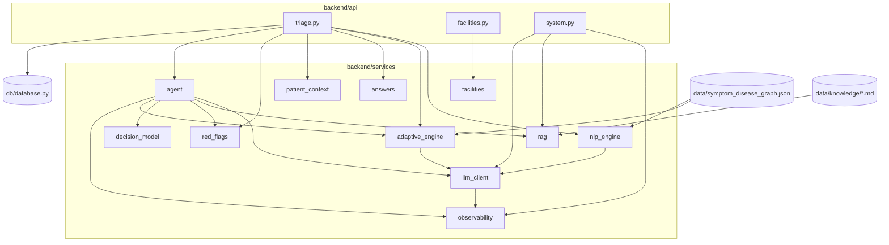
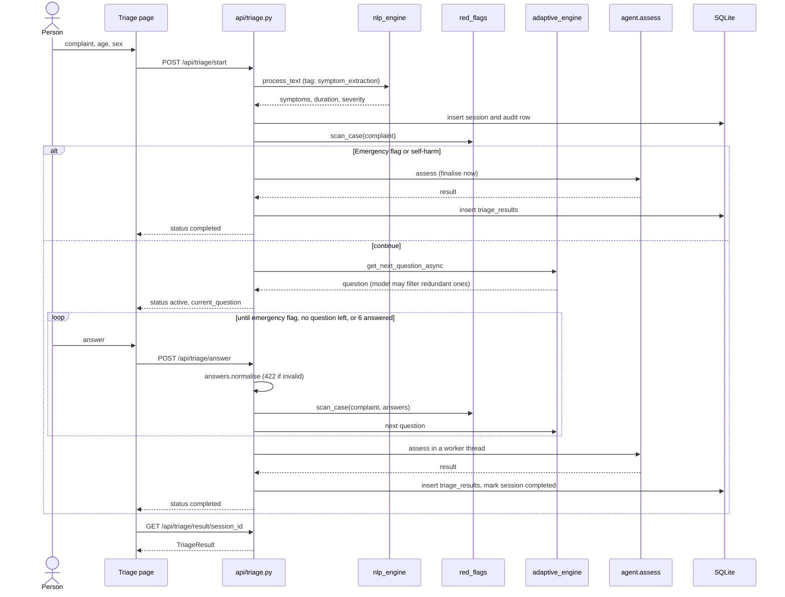
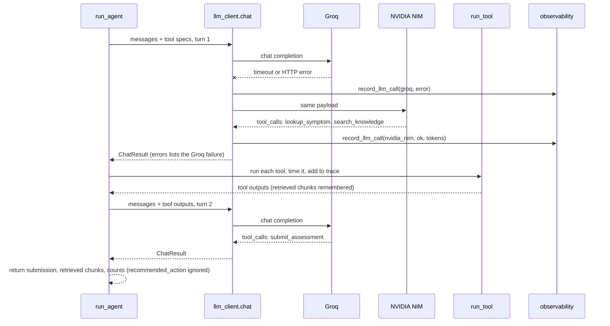
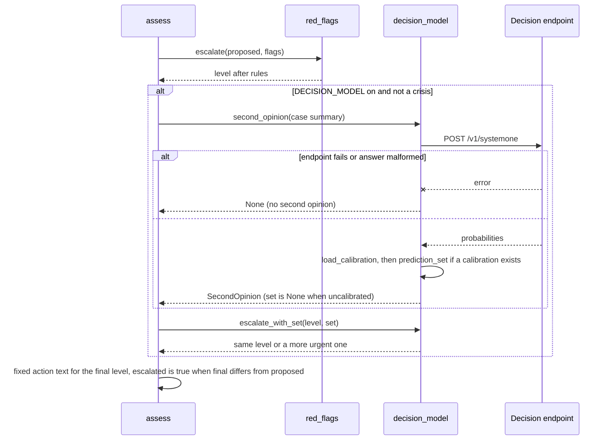

# Detailed Low-Level Design

Module-by-module description of HealthAI triage as it is implemented now: key functions and signatures, algorithms, data models, error handling and tests. For the big picture read [architecture.md](architecture.md) and [HLD.md](HLD.md) first. Paths are relative to the repository root.

> Portfolio project, not a medical device. It can be wrong. In an emergency, call 112.

Contents: [1 Layout](#1-layout-and-dependencies) - [2 Red-flag rules](#2-red-flag-rules) - [3 NLP engine](#3-nlp-engine) - [4 Adaptive questions and answers](#4-adaptive-questions-and-answer-validation) - [5 Agent and tools](#5-agent-loop-and-tools) - [6 LLM client](#6-llm-client) - [7 Retrieval](#7-retrieval-rag) - [8 Decision model and conformal](#8-decision-model-and-conformal-prediction) - [9 Facilities](#9-facilities) - [10 Observability](#10-observability-store) - [11 API routes](#11-api-routes-and-pydantic-schemas) - [12 Database](#12-database-and-session-state) - [13 Frontend](#13-frontend) - [14 CORS and config](#14-cors-and-configuration) - [15 Error handling](#15-error-handling-summary) - [16 Tests](#16-test-strategy) - [17 Known gaps](#17-known-gaps-in-the-code)

## 1. Layout and dependencies



Rules of the layout: API modules are thin and call services in a fixed order; `core/config.py` is the only place that reads environment settings (plus `CORS_ORIGINS`, `OBS_DB_PATH` and `EMBED_MODEL_DIR`, read where they are used); every model-dependent service has a non-model fallback.

### Sequence: one check from complaint to result



## 2. Red-flag rules

`backend/services/red_flags.py` (deterministic, no model).

```python
@dataclass(frozen=True)
class RedFlag:
    rule_id: str; level: str; reason: str; matched: str
    def to_dict(self) -> Dict

def scan_text(text: str) -> List[RedFlag]
def scan_case(complaint: str, answers: Optional[Dict[str, str]] = None, age: Optional[int] = None,
              symptoms: Optional[List[str]] = None, max_fever_temp_c: Optional[float] = None) -> List[RedFlag]
def highest_level(flags: List[RedFlag]) -> Optional[str]
def escalate(label: str, flags: List[RedFlag]) -> str      # never lowers
def is_crisis(flags: List[RedFlag]) -> bool                # any rule_id == "crisis_self_harm"
```

**Data.** `LEVELS = {"HomeCare": 0, "Urgent": 1, "Emergency": 2}`. `_RULES` has 15 text rules: 12 Emergency (self-harm crisis, severe chest pain, chest pain plus breathlessness or sweating or arm/jaw, severe breathing difficulty, stroke signs, thunderclap headache, meningitis signs, anaphylaxis, unconscious or seizure, severe bleeding, poisoning or overdose, pregnancy with bleeding or severe pain) and 3 Urgent (severe abdominal pain, high or prolonged fever, dehydration signs). `_YES_ANSWER_RULES` maps 19 question ids to a level and reason when answered "yes"; `_VALUE_ANSWER_RULES` has 4 non-yes triggers (for example `("bl_stop", "no")`, `("bl_amount", "heavy")`).

**Rule shape.** Each rule is `(rule_id, level, reason, [group, group, ...])`; a group is a list of regular expressions. A rule fires only when every group has at least one match, so "chest pain" AND "severe/crushing/..." are separate groups.

**Algorithm.**

1. `_norm` lowercases, folds typographic apostrophes and collapses whitespace.
2. `_any(text, patterns)` returns the first match that is not negated. A match is negated when `_NEGATION` (`no|without|denies|denied|never had|free of`, optionally followed by `any` and up to two words) ends the 40 characters before it. `not` is deliberately excluded so "not breathing" still fires.
3. `scan_case` adds answer-based rules (exact yes or value match), re-scans any free-text answer longer than three characters with `scan_text`, adds two age rules (fever in a baby under 12 months is Emergency; chest or breathing symptoms at 65 or over is Urgent), then de-duplicates by `rule_id` keeping the first.
4. `escalate(label, flags)` compares `LEVELS` and returns the higher; it has no code path that returns a lower level.

**Errors.** None are expected; the module is pure. Bad input (`None`) is handled by `_norm`.

**Tests** (`backend/tests/test_red_flags.py`, 38 cases): every emergency rule fires on a sample sentence (16 parametrised), negated symptoms do not fire (3), mild phrasing does not raise a false alarm (7), crisis phrasings (3), "not breathing" still fires, age rules, answer rules, free-text answers scanned, duplicates removed, and `escalate` never lowers (3).

## 3. NLP engine

`backend/services/nlp_engine.py`.

```python
def process_text(text: str, patient_age: Optional[int] = None, patient_gender: Optional[str] = None) -> dict
def extract_symptoms(text: str) -> List[str]            # LLM first, keyword fallback
def extract_symptoms_gemini(text: str) -> List[str]     # name is historical; uses llm_client, not Gemini
def extract_symptoms_keyword(text: str) -> List[str]
def extract_duration(text: str) -> Tuple[Optional[str], Optional[float]]   # (label, hours)
def extract_severity(text: str) -> Optional[int]
def detect_intent(text: str) -> str    # crisis | emergency_signal | greeting | query | symptom_report
def detect_language(text: str) -> str  # "hi" if more than two Devanagari characters, else "en"
```

- **Symptom extraction.** The LLM prompt lists the 16 valid symptom keys from `data/symptom_disease_graph.json` and asks for a JSON array. Only names that are in the graph survive (`valid = [s for s in parsed if s in valid_symptoms]`). The prompt tells the model to include only symptoms the text states; an earlier example in the prompt (`["fever", "headache"]`) was echoed back as a spurious fever chip (see [errorlog.md](errorlog.md)). If the model returns nothing usable, `extract_symptoms_keyword` matches symptom names and synonyms with word boundaries and the same negation idea ("no fever" does not add fever).
- **Duration.** First regex match over day, hour, week, month, minute patterns, converted to hours.
- **Severity.** An explicit "n out of 10" or "n/10" wins; otherwise the highest keyword score (for example `severe` 8, `unbearable` 10, `mild` 3).
- **Intent** is keyword-only on purpose (it used to trigger a second model call for no benefit). `crisis_detected` and `emergency_signal` are returned but the authority on emergencies is `red_flags`.
- **Returns** a dict with `entities`, `symptoms`, `intent`, `language_detected`, `severity_score`, `duration_text`, `duration_hours`, `crisis_detected`, `emergency_signal`.

**Errors.** Model errors are caught and logged; the keyword path then runs. A missing graph file logs an error and yields an empty graph.

**Tests** (`test_nlp.py`, 5): keyword extraction respects negation (4 phrasings); "greeting" needs a word boundary.

## 4. Adaptive questions and answer validation

`backend/services/adaptive_engine.py`:

```python
def get_questions_for_symptoms(symptoms: List[str], chief_complaint: str = "") -> List[Dict]
async def get_next_question_async(symptoms, answered, question_index, chief_complaint="") -> Optional[Dict]
async def filter_questions_with_gemini(questions, chief_complaint, answered, symptoms) -> List[Dict]  # name historical
def bayesian_urgency_update(base_urgency: str, answered: Dict[str, str], symptoms: List[str]) -> str
def get_diseases_for_symptoms(symptoms) -> List[str]          # first 6
def get_remedies_nutrition(symptoms) -> Dict                    # up to 6 of each
```

- **Question order.** Red-flag symptoms first (`red_flag: true` in the graph), then the rest; questions are de-duplicated by id across symptoms, and questions that merely ask whether the person has a symptom they already named are dropped by phrase matching. The graph holds 16 symptoms and 95 follow-up questions in total.
- **Model filter.** If a provider is configured, one extra model call (`purpose=question_filter`) returns the question ids worth keeping. An empty, malformed or failed reply returns the original list. This is the only model step in question selection.
- **`bayesian_urgency_update`** is, despite its name, a small additive score: start at the highest `base_urgency` of the symptoms (1/2/3), add fixed boosts for "yes" answers to named questions, cap at 3, round. It is used only by `rules_assessment` (the no-model fallback).

`backend/services/answers.py` validates a raw answer against the question type before it is stored:

```python
def normalise(question: Dict, raw: str) -> str          # raises AnswerError with a user-facing message
def case_updates(question: Dict, answer: str) -> Dict    # severity_score or duration_hours
def presentation(question: Dict) -> Tuple[str, Optional[List[str]]]   # type + button options
def parse_duration_hours(text: str) -> Optional[float]
```

Types: `yesno` (yes/no/not sure, with a few spellings such as "haan"), `scale` (integer 1-10, "7" or "7/10"), `duration` (presets such as "1-3 days" or free text such as "3 days"), `choice` (case-insensitive match against the options), `text` (max 500 characters). A scale answer feeds `severity_score`; a duration answer feeds `duration_hours`.

**Tests**: `test_answers.py` (23 cases: each type, rejections, presets, case updates, presentation).

## 5. Agent loop and tools

`backend/services/agent.py`.

```python
@dataclass
class Case: complaint; age; gender; symptoms; answers; questions; severity; duration_hours; def summary(self) -> str

def tool_specs() -> List[Dict]                         # OpenAI-style function specs
def run_tool(name: str, args: Dict, case: Case, retrieved: Dict[str, Dict]) -> Dict
def run_agent(case: Case, flags: List[RedFlag], trace: List[Dict]) -> Optional[Dict]
def rules_assessment(case: Case) -> Dict
def assess(case: Case, session_id: Optional[str] = None, source: str = "web", use_llm: bool = True) -> Dict
```

Constants: `LABELS = ["HomeCare", "Urgent", "Emergency"]`, `MAX_LLM_TURNS = 6`, and the fixed `ACTIONS` table (one sentence per level; the Emergency sentence is "Call emergency services (112) or go to the nearest emergency department now.").

**Tools** (all read-only):

| Tool | Behaviour |
|---|---|
| `lookup_symptom(symptom)` | Symptom must be one of the 16 graph keys (enum in the spec). Returns base urgency, whether it is a red-flag symptom and up to 7 associated conditions. Unknown key returns `{"error": "unknown symptom"}`. |
| `search_knowledge(query)` | `retriever.search(query, k=3, symptoms=case.symptoms)`. Every hit is stored in `retrieved` so citations can be checked later. |
| `check_red_flags(text)` | `scan_text`; returns flags and `floor_level`. |
| `submit_assessment(...)` | Ends the loop. Required fields: `triage_label`, `explanation`, `recommended_action` (the last is ignored). |

**`run_agent` algorithm.**

1. Messages: a system prompt (levels, "your level must not be lower than the red flags", cite only retrieved ids, no prescription medicines) and a user message with `Case.summary()` plus the red flags already found.
2. Up to `MAX_LLM_TURNS` iterations of `llm_client.chat(messages, tools=..., temperature=0.1, max_tokens=900)`. `None` means every provider failed: trace a failed step and return `None`.
3. If the model replies without tool calls it is nudged once ("Call submit_assessment now"); a second such reply breaks the loop.
4. Each tool call is executed, timed and appended to the trace; `submit_assessment` returns `{submission, retrieved, llm_calls, tool_calls, provider, model}` immediately. The submitted `recommended_action` is filtered out of the trace entry.
5. After the loop, a last-resort parse tries to read a JSON assessment from the final text reply. Otherwise a `no_submission` note is traced and `None` is returned.

### Sequence: the agent loop with a provider failover



**`assess` algorithm** (the pipeline in [architecture.md](architecture.md#3-the-decision-pipeline-inside-assess)):

```python
flags = red_flags.scan_case(...)
if crisis:                       # no model call at all
    base = fixed crisis response; citations = retriever.search("thoughts of suicide or self-harm support", k=2)
else:
    agent_out = run_agent(...) if use_llm and llm_client.has_any_provider() else None
    base = from agent (label coerced to a valid value, else "Urgent") or rules_assessment(case)
    citations = only chunk ids the agent retrieved; if none, a fallback retrieval on the complaint
opinion = decision_model.second_opinion(case.summary()) if not crisis and settings.DECISION_MODEL != "off"
proposed = base["triage_label"]
final = red_flags.escalate(proposed, flags)
if opinion and opinion.prediction_set: final = decision_model.escalate_with_set(final, opinion.prediction_set)
escalated = final != proposed          # explanation and action rewritten from the fixed table
observability.record_run(...)
```

Returned dict keys include `triage_label`, `proposed_label`, `escalated`, `explanation_text`, `recommended_action`, `key_factors`, `conditions_to_consider`, `self_care`, `nutrition_tips`, `probabilities` (only if the model supplied them, normalised to sum to 1, never invented), `red_flags`, `red_flag_triggered`, `crisis_response`, `citations`, `decision_path`, `fallback_reason`, `provider`, `model`, `llm_calls`, `tool_calls`, `latency_ms`, `agent_steps`, `symptoms`, `second_opinion`.

**Explanation consistency.** When a rule raises the level, the explanation is rewritten to state the rule's reason, the new level, and what the proposal alone would have said, so the text never contradicts the level.

**Trace entries** (`agent_steps`) are dicts with `kind` (`rule`, `llm`, `tool`, `model`, `note`), `name`, `summary` and optional `args`, `ms`, `provider`, `model`, `failovers`. The front end maps names to plain-language labels.

**Errors.** An exception inside `run_agent` is caught in `assess`, logged with a stack trace, traced as `agent_error`, and the rules path takes over (`fallback_reason="agent_failed"`). `assess` never raises for model failures.

**Tests** (`test_agent.py`, 12): happy path with tools and citation filtering, red flag escalates the agent's answer, escalated explanation does not contradict the level, failover to the second provider, all providers down, no provider configured, invalid label treated conservatively, plain-JSON reply after a nudge, giving up after the maximum turns, unknown tool and bad symptom do not crash, crisis bypasses the model, run is logged.

## 6. LLM client

`backend/services/llm_client.py`.

```python
PROVIDERS: List[Provider]            # groq, nvidia_nim, in that order
transport: Callable[[Provider, Dict], Dict]      # replaced in tests
def chat(messages, tools=None, temperature=0.2, max_tokens=900) -> Optional[ChatResult]
def configured_providers() -> List[str]; def has_any_provider() -> bool
def generate_text_with_fallback(prompt, temperature=0.2, max_tokens=900) -> Tuple[Optional[str], Optional[str]]
def generate_json_with_fallback(prompt, default, temperature=0.2, max_tokens=900) -> Tuple[Any, Optional[str]]
def extract_json(text: str) -> Any
```

`Provider` holds a name, URL and two callables for key and model, so settings changes apply without restart. Both providers speak the OpenAI chat-completions format. The default transport is `httpx.post(..., timeout=25.0)` with `raise_for_status()`.

`chat` loops over providers that have a key. For each: build the payload (`tool_choice="auto"` when tools are given), call `transport`, parse tool-call arguments (`json.loads`, falling back to `{"_raw": ...}`), record an `ok` row with token counts. Any exception is described (`HTTP 429`, `timeout`, exception type), appended to `errors`, recorded as an `error` row and logged; the loop moves to the next provider. If none succeeds it returns `None`. A success returns a `ChatResult` whose `errors` lists the failures of earlier providers, which the trace shows as "Failed first".

`extract_json` strips a Markdown code fence if present, then falls back to a regex for the first `{...}` or `[...]`.

> The module docstring still says "Llama 3.3 70B / Llama 3.1 70B"; the defaults in `core/config.py` are `openai/gpt-oss-120b` and `openai/gpt-oss-20b` (see [errorlog.md](errorlog.md)).

## 7. Retrieval (RAG)

`backend/services/rag.py`, a module-level singleton `retriever = Retriever()`.

- **Notes.** `data/knowledge/*.md` (23 notes, README excluded). Each starts with front matter (`id`, `title`, `url`, `symptoms`) and has `##` sections; each section is one chunk with id `<note-id>#<section-slug>`. Loading yields 62 chunks. Every note links to a MedlinePlus page.
- **Index.** On first use (`ensure_loaded`, guarded by a lock and also called at startup) the retriever loads the `minishlab/potion-base-8M` model2vec static embedding model from `backend/models_cache/potion-base-8M` (fetched by `backend/scripts/fetch_embedder.py`) and embeds `"{title}. {section}. {text}"` for every chunk, L2-normalised. If the model cannot be loaded it logs a warning and uses mode `keyword`.
- **Scoring** in `search(query, k=3, symptoms=None)`:

```text
keyword  = |query tokens ∩ chunk tokens| / |query tokens|          (stop words and tokens of 2 chars or fewer removed)
dense    = chunk_matrix @ normalised_query_embedding                (embeddings mode only)
score    = 0.7 * dense + 0.3 * keyword      (embeddings)   |   keyword   (fallback)
final    = score + 0.08 if the note is about one of the patient's symptoms
```

Top `k` with `final > 0` are returned as citation dicts (`chunk_id`, `title`, `section`, `text`, `url`, `score`). The exact-term weight exists to rescue rare clinical words ("drooping", "slurred") that a small embedding model blurs.

- **`status()`** returns `{mode, chunks, notes, model}`; `GET /api/system/status` and `GET /api/knowledge` expose it.

**Tests** (`test_rag.py`, 10): every note parses and has a URL, section parsing, 6 relevance queries return the expected note, empty query, keyword fallback mode.

## 8. Decision model and conformal prediction

`backend/services/decision_model.py`, off by default (`DECISION_MODEL=off`).

```python
def calibrate(probs: Sequence[dict], truths: Sequence[str], alpha: float = 0.1) -> Calibration
def prediction_set(probabilities: dict, quantile: float) -> list[str]        # never empty
def escalate_with_set(label: str, labels_in_set: Sequence[str]) -> str       # only raises
def evaluate_leave_one_out(probs, truths, alpha=0.1) -> dict
def load_calibration(path=None) -> Calibration | None
def query_model(case_summary: str, transport=None) -> dict[str, float] | None
def second_opinion(case_summary: str, transport=None) -> SecondOpinion | None
```

**Split conformal.** Nonconformity of a case is `1 - p(true label)`. With `n` calibration cases the quantile is the `ceil((n + 1)(1 - alpha))`-th smallest score (or `1.0` if that rank exceeds `n`). At run time the set holds every level whose `1 - p` is at most the quantile; if that is empty, the single most probable level is used. Under exchangeability this gives `P(true level in set) >= 1 - alpha`, with no assumption that the model is well calibrated. Calibration comes from `evals/decision_eval.py --write-calibration`, which writes `backend/models/conformal.json` (`{alpha, quantile, n}`).

**Client.** `query_model` returns `None` when the mode is off or no URL is set. Otherwise it sends `POST {SYSTEMONE_URL}/v1/systemone` with `{"model", "input", "output_schema"}` and an optional bearer key, and accepts `{"probabilities": ...}` or `{"output": {"probabilities": ...}}`. Probabilities are clamped at zero and renormalised. Any exception (network, status, JSON) logs a warning and returns `None`.

### Sequence: second opinion and safety merge



**Safety.** No calibration means `prediction_set=None`, so nothing is escalated and the UI says the opinion is for information only. Self-harm crises skip the module entirely. It can only raise a level.

**Status.** Code and tests exist; no endpoint has been run against the 60 cases here, so no coverage or accuracy figure exists (see [results.md](results.md)).

**Tests** (`test_decision_model.py`, 25): quantile arithmetic and edge cases, bad alpha, set never empty, `escalate_with_set` only raises (5), leave-one-out, corrupt or missing calibration, request shape and auth header, transport errors swallowed, and four `assess()` integration tests (unchanged when off, never lowers and ignores uncalibrated opinions, raises when the set holds a more urgent level, skipped during a crisis).

## 9. Facilities

`backend/services/facilities.py`, real places from OpenStreetMap instead of a model-written list.

```python
def build_query(lat, lon, amenities, radius_m) -> str            # Overpass QL
def parse_elements(elements, lat, lon, urgency) -> List[Dict]
async def nearby(lat: float, lon: float, urgency: str, limit: int = 6) -> Dict
async def geocode(query: str) -> Optional[Dict]                  # Nominatim
def haversine_km(lat1, lon1, lat2, lon2) -> float
```

- `AMENITIES`: Emergency to hospitals; Urgent to hospitals, clinics, doctors; HomeCare to pharmacies, clinics, doctors.
- `nearby` widens the search radius 3 km, 8 km, 20 km until at least 3 named results exist, caches the payload for 3600 seconds keyed by `(round(lat, 2), round(lon, 2), urgency)`, and returns `facilities`, `radius_km`, `amenities`, `source`.
- `parse_elements` drops unnamed or coordinate-less elements, de-duplicates on `(name, rounded lat, rounded lon)`, adds distance, address, phone and OSM and directions links, and sorts by distance; for an emergency, hospitals known to have an emergency department (`emergency=yes`) sort first.
- `_overpass` tries two mirrors in turn and raises `RuntimeError` if both fail.
- **Route errors** (`api/facilities.py`): 422 if neither coordinates nor a place are given; 404 if geocoding finds nothing; 502 with a plain message if geocoding or the map service fails.

**Tests** (`test_facilities.py`, 5): haversine, query uses the amenities for the level, parse sorts, de-duplicates and drops unnamed, emergency departments first, radius widening and caching.

## 10. Observability store

`backend/services/observability.py`, a separate SQLite connection (`check_same_thread=False`) guarded by a `threading.Lock`.

```python
@contextmanager
def tagged(session_id: Optional[str], purpose: str) -> Iterator[None]      # sets two ContextVars
def record_llm_call(provider, model, status, latency_ms, prompt_tokens=None, completion_tokens=None,
                    tool_calls=0, error=None) -> None
def record_run(session_id, decision_path, label, escalated, red_flags, fallback_reason, latency_ms,
               llm_calls, tool_calls, source="web") -> None
def summary(window_hours: float = 168, include_eval: bool = False) -> Dict
def recent_calls(limit: int = 50); def recent_runs(limit: int = 50); def timeseries(window_hours=24, bucket_minutes=60)
def reset_for_tests(path: str) -> None
```

`tagged` uses `contextvars` so a call made in a worker thread (`run_in_threadpool` copies the context) is attributed to the right session and purpose. `summary` returns LLM calls, errors, error rate, p50 and p95 latency, token totals, per-provider and per-purpose counts, and triage counts by decision path and label, escalations, fallback rate and average model calls. Percentiles use nearest rank. Both write functions catch `sqlite3.Error` and do nothing, so a monitoring fault cannot fail a check.

**Tests** (`test_observability.py`, 3): empty store, summary and recent rows, tags reset after the block.

## 11. API routes and Pydantic schemas

All routes are mounted by `backend/main.py`; OpenAPI docs at `/api/docs` and `/api/redoc`.

| Method and path | Request | Response | Notes |
|---|---|---|---|
| `GET /health` | | `{status, version}` | |
| `POST /api/triage/start` | `TriageStartRequest` | `TriageSessionState` | Extract symptoms, scan rules, first question or result |
| `POST /api/triage/answer` | `AnswerRequest` | `TriageSessionState` | 404 unknown or expired session; 400 already complete; 422 invalid answer |
| `GET /api/triage/result/{session_id}` | | `TriageResult` | 404 if no result yet |
| `POST /api/triage/assess` | `AssessRequest` | `TriageResult` | One call; `source` is `api`, `eval` or `web`; `use_llm=false` forces the rules path |
| `GET /api/triage/history` | | `{sessions: [...]}` | Last 20 sessions, server side |
| `GET /api/facilities/nearby` | query: `urgency`, `lat`, `lon` or `place` | facilities payload | 422, 404, 502 as above |
| `GET /api/system/status` | | version, providers, models, `agent_enabled`, knowledge-base status | |
| `GET /api/metrics/summary`, `/calls`, `/runs`, `/timeseries` | query limits | from the observability store | `hours` capped at 90 days |
| `GET /api/evals`, `/api/evals/{name}` | | eval reports from `evals/results/*.json` | `os.path.basename` blocks path traversal; 404 if absent |
| `GET /api/knowledge` | | every chunk the retriever can cite | |

Key models in `backend/schemas/models.py`:

```python
class TriageStartRequest(BaseModel):   # chief_complaint: str (3-1000 chars), patient_age: Optional[int] (0-120),
                                       # patient_gender: Optional[Gender], language: str = "en"
class AnswerRequest(BaseModel):        # session_id, question_id, answer
class AssessRequest(BaseModel):        # chief_complaint, patient_age, patient_gender, answers: dict,
                                       # use_llm: bool = True, source: str pattern ^(api|eval|web)$
class QuestionResponse(BaseModel):     # question_id, question_text, answer_type: AnswerType, options
class TriageSessionState(BaseModel):   # session_id, status (active|completed), current_question,
                                       # progress_percent, extracted_symptoms, message
class TriageResult(BaseModel):         # triage_label, proposed_label, escalated, probabilities, red_flags,
                                       # explanation_text, recommended_action, key_factors, conditions_to_consider,
                                       # self_care, nutrition_tips, citations, crisis_response, decision_path,
                                       # fallback_reason, provider, model, llm_calls, tool_calls, latency_ms,
                                       # agent_steps, second_opinion, symptoms, chief_complaint, created_at
```

Enums: `Gender` (male, female, other, prefer_not_to_say), `TriageLabel` (Emergency, Urgent, HomeCare), `AnswerType` (yesno, text, scale, choice, duration). `models.py` also still contains models from the earlier version that no route uses (registration and login, `SHAPFeature`, `Hospital`, `NLPResult`).

**Special questions.** `clarify_symptoms` is a synthetic question id used when no symptoms were found; its answer is re-run through the NLP step and merged into the complaint and symptoms.

**Error handling.** `main.py` registers a global exception handler returning HTTP 500 with a plain message and logging the real error. Validation errors are Pydantic 422s; user-facing answer errors are 422 with the sentence from `AnswerError`.

**Tests** (`test_api.py`, 12): full flow with typed questions, invalid answer, question cap, emergency complaint short-circuits, yes to a red-flag question ends as Emergency, clarify when no symptoms, one-shot assess with and without the agent, unknown session and result, system, metrics and knowledge endpoints, evals endpoints, facilities endpoint.

## 12. Database and session state

`backend/db/database.py` (SQLAlchemy 2 async, `DATABASE_URL`, default `sqlite+aiosqlite:///./health_triage.db`). Tables created by `init_db()` from the ORM:

| Table | Columns that matter |
|---|---|
| `sessions` | `id` (uuid string), `session_token`, `status` (active or completed), `chief_complaint`, `patient_age`, `patient_gender`, `started_at`, `completed_at`, `question_index`, `total_questions` |
| `triage_results` | `session_id`, `triage_label`, `confidence` (always null; kept so no number is invented), `probabilities` (JSON), `red_flag_triggered`, `red_flag_reason`, `explanation_text`, `recommended_action`, `diseases_considered`, `remedies`, `nutrition_tips`, `medications` (always empty), `crisis_response`, `details` (JSON: proposed label, escalated, red flags, key factors, citations, decision path, fallback reason, provider, model, call counts, latency, `agent_steps`, symptoms, second opinion), `created_at` |
| `audit_logs` | `session_id`, `event_type`, `event_data` (JSON), `ip_hash` (SHA-256 prefix of the client IP, never the IP), `created_at` |
| `users` | present in the ORM from the earlier version; not used by any route |

`init_db` and `_ensure_runtime_schema` add the `medications` and `details` columns to older databases (`PRAGMA table_info` on SQLite, `ADD COLUMN IF NOT EXISTS` on Postgres) so an existing file keeps working. `backend/db/schema.sql` (Postgres) and `schema_sqlite.sql` are reference scripts; the SQLite one also lists a `session_symptoms` table that the ORM does not create. `get_db()` commits on success and rolls back on exception.

**Session context** (`services/patient_context.py`): a JSON document per session (complaint, age, gender, symptoms, severity, duration, `answered`, `question_index`, `status`) stored in a module-level dict by default, or in Redis with a TTL (`SESSION_EXPIRE_SECONDS`, 3600) when `USE_MEMORY_SESSION=false`. The in-memory store has no eviction and `delete_session` has no caller, so it grows for the life of the process.

**Observability store**: two tables in a separate SQLite file; see [section 10](#10-observability-store).

## 13. Frontend

`frontend/src`, React 18, React Router 6, axios, recharts (Ops charts), framer-motion, lucide-react, react-hot-toast. Build tool is Vite; there is no TypeScript and no global state library.

**Routes** (`App.jsx`): `/` Landing, `/triage` Triage, `/result/:sessionId` Result, `/history` History, `/evals` Evals (lazy), `/ops` Ops (lazy), anything else redirects to `/`. `?tour=1` opens the app tour; the `Tour` component is mounted once at the app level and its open state lives in `App`.

**State.** Local component state (`useState`, `useRef`) only:

- `Triage.jsx` holds the form, the last `TriageSessionState`, the chat `thread`, the answered pairs, `busy` and error state. It calls `triageAPI.start`, then `answer` repeatedly; on `status === "completed"` it fetches the result, saves it with `saveResult`, and navigates to `/result/:id` passing the result in router state.
- `Result.jsx` uses the router-state result if present; otherwise fetches by id and, if the server no longer has it, falls back to the browser copy with a visible notice.
- `lib/history.js` wraps `localStorage` (key `healthai.history.v1`, 30 entries) in try/catch, so a blocked or full store never breaks the app.
- `lib/labels.js` maps levels, decision paths and fallback reasons to plain-language text (for example `Emergency` to "Call 112 or go to an emergency department.").

**Components.** `IntakeFields` (complaint, age, sex), `AnswerInput` (a control per question type: 1-10 buttons, yes/no/not sure buttons, duration presets with "type it instead", free text up to 500 characters), `TriageTag` (level banner), `AgentTrace` (the ordered steps, with plain names such as "Searched the knowledge base", model and latency, and "Failed first" for failover), `Citations`, `Facilities` (browser geolocation or typed place, then `GET /api/facilities/nearby`), `Navbar`, `Footer`, `Tour`.

**Errors.** `errorMessage(err)` in `api/client.js` converts any failure to a sentence: server `detail` text, a timeout message (client timeout is 60 s), or "Can't reach the server. It may be waking up; try again in a few seconds." The Result page shows the crisis block (two helplines and 112) whenever `crisis_response` is true.

**API base.** `VITE_API_URL` at build time, else empty so the Vite dev server proxies `/api` to `http://localhost:8000`.

There are no front-end unit tests; the front end is covered by the CI build (`npm ci && npm run build`).

## 14. CORS and configuration

```python
app.add_middleware(
    CORSMiddleware,
    allow_origins=[o.strip() for o in os.environ.get("CORS_ORIGINS", "http://localhost:5173,https://healthai-triage.onrender.com").split(",")],
    allow_credentials=False, allow_methods=["*"], allow_headers=["*"])
```

The API uses no cookies or sessions-by-cookie, so credentials are off; an allowlist replaces the earlier wildcard. Tests: `test_cors.py` (2) checks the deployed origin is echoed and an unknown origin gets no `Access-Control-Allow-Origin` and no credentials header.

`backend/core/config.py` (`pydantic-settings`, `.env` supported) holds: `GROQ_API_KEY`, `GROQ_MODEL`, `NVIDIA_NIM_API_KEY`, `NVIDIA_NIM_MODEL`, `DECISION_MODEL`, `SYSTEMONE_URL`, `SYSTEMONE_MODEL`, `SYSTEMONE_API_KEY`, `SYSTEMONE_TIMEOUT`, `CONFORMAL_PATH`, `DATABASE_URL`, `SECRET_KEY`, `REDIS_URL`, `USE_MEMORY_SESSION`, `SESSION_EXPIRE_SECONDS`, `DATA_DIR`. A few settings (`GEMINI_API_KEY`, `GOOGLE_MAPS_API_KEY`, `SPACY_MODEL`, `TRIAGE_MODEL_PATH`) are leftovers from the earlier version and are not read by the live code paths. Keys come from the environment only; `.env` and `*.db` are git-ignored.

## 15. Error handling summary

| Failure | Where handled | Result |
|---|---|---|
| Provider timeout, HTTP error, bad body | `llm_client.chat` | Next provider; error row recorded; `Failed first` in the trace |
| All providers fail | `run_agent` returns `None` | Rule-based assessment, `fallback_reason=agent_failed` |
| Agent raises | `assess` try/except | Logged, `agent_error` note, rules path |
| Invalid label or malformed submission | `assess` | Label coerced to `Urgent`; probabilities dropped if unusable |
| Hallucinated citation id | `assess` | Dropped; only retrieved chunks are shown |
| Embedding model missing | `Retriever.ensure_loaded` | Keyword retrieval |
| Decision model unreachable or malformed | `query_model` | No second opinion |
| Overpass or Nominatim failure | `api/facilities.py` | 502 with a plain message |
| Observability DB error | `record_*` | Ignored |
| Anything unhandled | `main.py` handler | HTTP 500, plain message, error logged |

## 16. Test strategy

135 tests (`cd backend && python -m pytest`, about 5 seconds), no network.

| File | Tests | Covers |
|---|---|---|
| `test_red_flags.py` | 38 | Rule firing, negation, false-alarm guards, escalate-only, answer and age rules |
| `test_decision_model.py` | 25 | Conformal maths, request/response handling, `assess()` integration |
| `test_answers.py` | 23 | Per-type validation and normalisation |
| `test_agent.py` | 12 | Tool loop, failover, fallbacks, safety merge, citation filtering |
| `test_api.py` | 12 | End-to-end routes through an in-process ASGI client (`httpx.ASGITransport`) |
| `test_rag.py` | 10 | Parsing, retrieval relevance, keyword fallback |
| `test_facilities.py` | 5 | Query building, ranking, caching |
| `test_nlp.py` | 5 | Negation, intent boundaries |
| `test_observability.py` | 3 | Store, summaries, tagging |
| `test_cors.py` | 2 | Origin allowlist |

**Fake LLM transport.** `conftest.py` sets throwaway database paths, blanks the API keys, and provides `ScriptedLLM`, a callable with the same signature as `llm_client.transport` that returns scripted replies in order, can be told that named providers are down, and records every request. A `fake_llm` fixture (with dummy keys for both providers) installs it as `llm_client.transport`, so the real client code (payload building, tool-call parsing, failover, observability rows) runs unchanged and only the HTTP call is replaced. Helper builders `tool_call(...)` and `reply(...)` create OpenAI-format responses. An autouse fixture points the observability store at a fresh file per test. A scripted reply list that runs out raises, so a test cannot silently under-specify the conversation.

**What is not covered by unit tests**: real provider behaviour (rate limits, model ids), real Overpass responses, the browser UI, and the agent's accuracy. Accuracy is the job of the eval harness (`evals/run_eval.py`): the rules pipeline runs in CI as a gate; the agent pipeline runs in CI only when a key secret is configured and has not been measured in this repository.

**Eval gates** (`evals/run_eval.py`): rules pipeline, over cases tagged `red_flag_*`: zero critical misses and emergency recall 1.0; agent pipeline, over all cases: zero critical misses and emergency recall at least 0.9; any errored case also fails. A critical miss is an Emergency case answered HomeCare.

## 17. Known gaps in the code

- `assess()` in `agent.py` is a long function (the CI complexity gate carves it out).
- Session context is in process memory by default and never evicted.
- The question filter is a model step that can remove questions; the safety floor is unaffected, but information gathered can be less complete.
- Some names are historical (`extract_symptoms_gemini`, `filter_questions_with_gemini`) and the `llm_client` and `nlp_engine` docstrings still mention models the code no longer uses.
- Unused leftovers from the earlier version: auth schemas and `core/security.py`, `users` table, a few settings.
- The two Indian helpline numbers in the crisis response are hard-coded in `agent.py` and `Result.jsx` and are not verified by any test or automated check.
