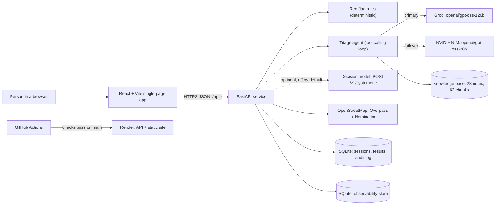
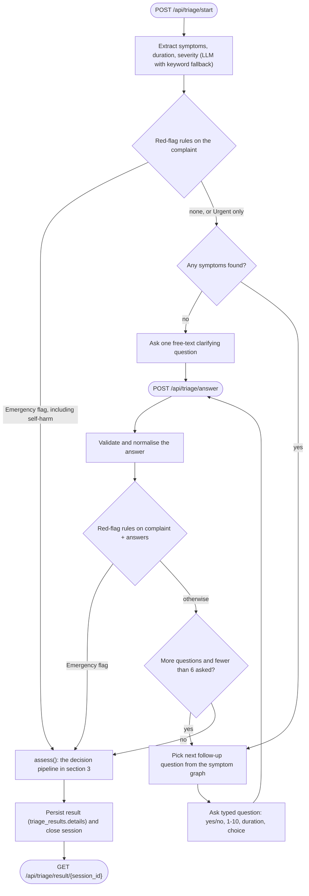
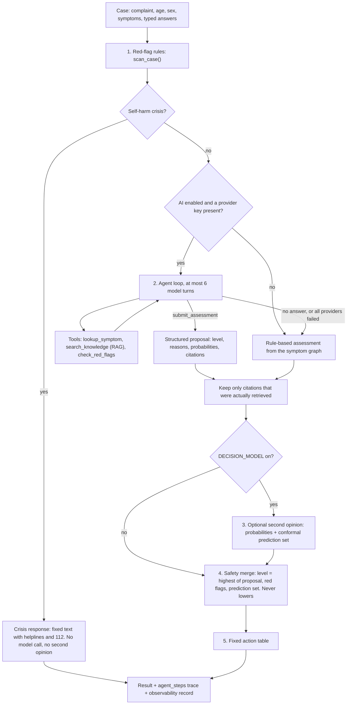
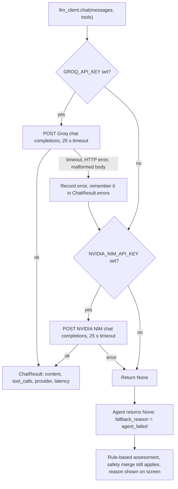
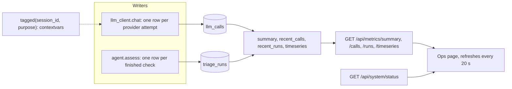
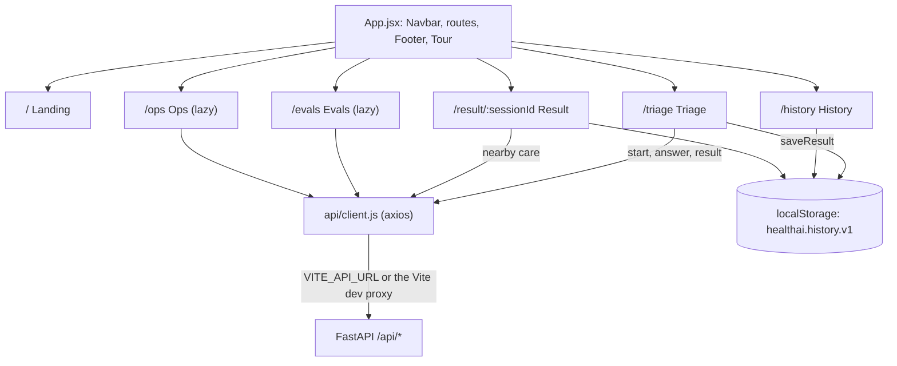
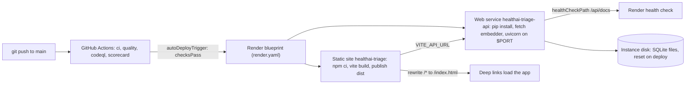

# Architecture

HealthAI triage turns a free-text complaint into one of three levels (home care, urgent, emergency) with reasons and sources. This document describes the system as it exists now: what runs where, in what order, and what happens when a part fails.

> Portfolio project, not a medical device. It can be wrong. In an emergency, call 112.

Related documents: [High-level design](HLD.md) (why it is built this way), [Low-level design](LLD.md) (modules, signatures, schemas), [Results](results.md) (measured outcomes), [Error log](errorlog.md) (what broke and how it was fixed). The `PROJECT_*.md` files in this folder are planning notes from the earlier, pre-agent version and are not current.

## 1. System context

One React single-page app talks to one stateless-by-design FastAPI service (with two caveats listed in section 9). The service calls out to two LLM providers, OpenStreetMap services, and optionally a decision-model endpoint. Nothing else is required to run it.

The model ids shown are the defaults in `backend/core/config.py` (`GROQ_MODEL`, `NVIDIA_NIM_MODEL`); both are overridable by environment variable. The 62 chunks come from loading `data/knowledge/` with `services/rag.load_chunks()`.

## 2. Request flow for one check

A check is a short conversation. `POST /api/triage/start` reads the complaint, and the red-flag rules run before any question is asked. `POST /api/triage/answer` repeats the rule scan after every answer. When the rules find an emergency, or the questions run out (cap of 6), the case is assessed.

`POST /api/triage/assess` runs the same `assess()` in one call without the question loop (used by the eval harness, sample cases and API clients).

## 3. The decision pipeline inside `assess()`

This is the part that matters for safety. The order is fixed in code (`backend/services/agent.py`).

Reading the diagram:

1. **Red-flag rules run first and always.** They are regular expressions plus answer-based rules (`backend/services/red_flags.py`). They produce a floor.
2. **The agent proposes.** It may call `lookup_symptom`, `search_knowledge` (hybrid retrieval over the knowledge base) and `check_red_flags`, and must finish with `submit_assessment`. Citations it did not retrieve in this run are dropped.
3. **The optional second opinion** returns probabilities for the three levels. Only if a calibration file exists is a conformal prediction set produced; without it the opinion is shown for information and cannot change the level.
4. **The safety merge only raises.** `final = max(proposal, strongest red flag, most urgent level in the prediction set)`.
5. **The action text comes from a fixed table**, never from the model: the Emergency line is "Call emergency services (112) or go to the nearest emergency department now." The model's free-text `recommended_action` is accepted by the tool schema but ignored, and is removed from the displayed trace.

## 4. Provider failover and degradation

`backend/services/llm_client.py` tries providers in order for every call. Each attempt, success or failure, is written to the observability store.

Every model-dependent step has a non-model fallback:

| Step | If the model is missing or fails |
|---|---|
| Symptom extraction (`nlp_engine`) | Keyword and synonym match over the symptom graph, negation-aware |
| Follow-up question filter (`adaptive_engine`) | The unfiltered question list is used |
| Agent assessment (`agent`) | `rules_assessment()` from the symptom graph, severity and duration; `fallback_reason` is `no_llm_provider`, `llm_disabled` or `agent_failed` |
| Retrieval embeddings (`rag`) | Keyword overlap only; `/api/system/status` reports the mode |
| Decision model (`decision_model`) | Returns `None`; triage carries on with no second opinion |
| Nearby care (`facilities`) | Two Overpass mirrors tried in turn; the endpoint returns 502 with a plain message if both fail |

The result always states which path produced it (`decision_path`: `agent`, `rules` or `red_flag`) and why a fallback was used.

## 5. Observability and Ops

`backend/services/observability.py` keeps its own SQLite file (`OBS_DB_PATH`, default `backend/observability.db`), separate from the application database so it can be written from the synchronous LLM client without an event loop. Writes swallow `sqlite3.Error` so monitoring can never break triage.

- `llm_calls` holds provider, model, status (`ok` or `error`), latency, token counts, tool-call count and a truncated error (300 characters). `purpose` is one of `symptom_extraction`, `question_filter`, `triage_agent` (or `unspecified`).
- `triage_runs` holds decision path, final label, whether it was escalated, the rule ids that fired, fallback reason, latency, model and tool-call counts, and a `source` (`web`, `api` or `eval`). Summaries exclude `eval` runs unless asked.
- The store lives on the instance disk and resets on each deploy.

## 6. Frontend

A Vite-built React 18 app using React Router. The chart-heavy pages are lazy-loaded so the symptom checker stays light.

- **Landing** introduces the tool and starts the app tour. **Triage** is the intake form plus a chat-style question flow with a "case so far" panel. **Result** shows the level, reasons, red flags, sources, the second opinion if present, the agent trace and nearby care. **History** lists results kept in this browser. **Evals** renders the published eval reports. **Ops** shows the model-call dashboard.
- Past results are stored only in the visitor's browser (up to 30 entries). If the server cannot return a stored result, the Result page falls back to the browser copy.
- Direct links to client-side routes (for example `/result/...`) need the static host to serve `index.html` for unknown paths; see section 7.

## 7. Deployment

- **Render** (`render.yaml`): a Python web service for the API and a static site for the front end. Both deploy only after GitHub checks pass. Secrets (`GROQ_API_KEY`, `NVIDIA_NIM_API_KEY`, `VITE_API_URL`) are declared with `sync: false` and entered in the Render dashboard.
- **Vercel** (`vercel.json`, `api/index.py`) is an alternative host: `/api/*` goes to the serverless entry that exposes the same FastAPI app, everything else to `index.html`.
- **CORS**: the API allows only `CORS_ORIGINS` (default `http://localhost:5173` and `https://healthai-triage.onrender.com`) and sets no credentials.
- **CI** (`.github/workflows`): `ci.yml` (ruff, 135 backend tests, gated rules eval, agent eval only when a key secret exists, front-end build), `quality.yml` (vulture, radon/xenon, jscpd), `codeql.yml`, `scorecard.yml`, and monthly grouped Dependabot updates.

## 8. Startup sequence

`backend/main.py` startup: create `logs/`, `init_db()` (creates tables and patches older SQLite or Postgres databases with the `medications` and `details` columns), then `retriever.ensure_loaded()` in a worker thread so the first patient does not wait for the embedding model.

## 9. Architectural caveats

- **In-progress session state is in process memory** by default (`USE_MEMORY_SESSION=True`, `services/patient_context.py`). Running more than one API instance, or restarting mid-check, loses sessions unless Redis is enabled (`USE_MEMORY_SESSION=false`, `REDIS_URL`). Finished results are in SQLite.
- **SQLite on the instance disk** resets on deploy. `backend/db/schema.sql` is a Postgres schema ready for a move.
- **Nearby-care results are cached in memory** for an hour per rounded location.
- **The follow-up question filter is a model step** (`purpose=question_filter`). It can drop questions that look redundant; the red-flag rules still scan the complaint and every answer, so the safety floor does not depend on it.
- **The optional decision model has not been evaluated in this repository.** See [results.md](results.md).
